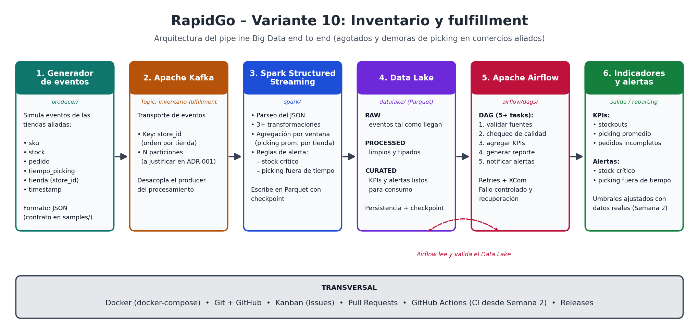

# RapidGo - Variante 10: Inventario y fulfillment

Pipeline Big Data de punta a punta (Kafka → Spark Structured Streaming → Data Lake Parquet → Airflow) que detecta **agotados de inventario** y **demoras de picking** en comercios aliados de RapidGo.

- **Proyecto final:** Big Data - RapidGo
- **Variante:** 10 - Inventario y fulfillment
- **Equipo:** 
    Juan Acevedo (Semana 1=A /Semana 2=A / Semana 3=B / Semana 4=A),
    Wilson Cristancho (Semana 1=B /Semana 2=B / Semana 3=A / Semana 4=B),
    Santiago Mahecha (Semana 1=C /Semana 2=C / Semana 3=C / Semana 4=C),

- **Video final (máx. 10 min):** https://drive.google.com/drive/folders/12BpmzrUyx-gQOugeMzssXYFnBCTiFXWw?usp=sharing

## 1. Problema de negocio y valor

RapidGo entrega pedidos de comercios aliados. Si un SKU se agota o el picking (armar el pedido en la tienda) tarda demasiado, el pedido sale incompleto o tarde. Hoy eso se descubre cuando el cliente ya reclamó.

La solución procesa los eventos de cada pedido a medida que llegan y:

- Dispara **alertas** cuando el stock es crítico o el picking supera el tiempo permitido.
- Calcula **KPIs** por tienda (picking promedio, pedidos incompletos, agotados) en ventanas de 5 minutos.
- Valida la **calidad** de los datos y deja un **reporte** de cada ejecución, orquestado con Airflow.

## 2. Arquitectura



```
producer ──► Kafka ──► Spark Structured Streaming ──► Data Lake (Parquet) ──► Airflow
(eventos)   (topic)    (parseo, limpieza, ventanas)    Raw → Processed → Curated  (calidad, KPIs, reporte)
```

Decisiones principales (detalle en `docs/decisions/`):

- **ADR-002:** la key del mensaje es `store_id` y el topic tiene 3 particiones, observadas con eventos reales.
- **ADR-003:** Airflow en modo `standalone` con reintentos y recuperación re-ejecutando solo las tareas afectadas.

## 3. Tecnologías y su rol

| Tecnología                                        | Rol 
|
| Python 3.13                         | Producer de eventos, lógica de reglas, KPIs y calidad (funciones puras, fáciles de probar) |
| Apache Kafka 3.8 (KRaft)            | Transporte de eventos en el topic `inventario-fulfillment` |
| Spark 3.5.3 Structured Streaming    | Consume de Kafka, parsea, limpia, deduplica y agrega por ventana |
| Parquet                             | Data Lake en tres capas: Raw, Processed y Curated, con checkpoints |
| Apache Airflow 3.3.2                | Orquesta la validación de fuentes y calidad, los KPIs y el reporte |
| Docker Compose                      | Levanta Kafka, Spark y Airflow con un comando |
| pytest                              | Pruebas de contrato, reglas, transformaciones, calidad, KPIs y DAG |
| GitHub Actions                      | CI como quality gate y release automatizado |

## 4. Prerrequisitos y ejecución local

Se necesita: Git, **Docker Desktop abierto**, Python 3.13 y (opcional, para ejecutar pruebas) un entorno virtual.

```bash
git clone https://github.com/Acv3-1/BIG_DATA.git
cd BIG_DATA
pip install -r requirements.txt

# 1. Kafka, creación del topic y Spark (job continuo que escribe en ./datalake)
docker compose up -d kafka kafka-init spark

# 2. Generar eventos (en otra terminal)
python -m producer.producer --count 200 --rate 20

# 3. Airflow
docker compose up -d airflow
```

Para ver los eventos sin Kafka: `python -m producer.producer --dry-run --count 5`.
Para detener todo: `docker compose stop` (conserva el historial de Airflow) o `docker compose down -v` (lo borra).

## 5. Topic, eventos, KPIs y reglas

**Topic:** `inventario-fulfillment` · 3 particiones · key = `store_id`.

**Evento** (ejemplo completo en `samples/evento-ejemplo.json`):

```json
{
  "event_id": "3f2b8c1e-7d4a-4b59-9a62-0c1d5e8f7a10",
  "team": "equipo-variante10", "variant": 10,
  "store_id": "S003", "order_id": "PED-482913", "sku": "SKU-0007",
  "stock": 4, "items_requested": 3, "items_picked": 2,
  "picking_time_sec": 725, "event_ts": "2026-10-29T15:55:00.123Z"
}
```

**KPIs** (ventana de 5 min con watermark de 10 min, por tienda):

| KPI                             | Definición |
|
| Picking promedio          | Promedio de `picking_time_sec` por tienda y ventana |
| Pedidos incompletos       | Pedidos con `items_picked < items_requested` (cantidad y %) |
| Agotados (stockouts)      | Eventos con `stock == 0` |

**Reglas de alerta** (`spark/reglas.py`; los umbrales se ajustan por variable de entorno):

| Alerta                        | Condición                         | Umbral inicial 
|---|---|---|
| `STOCK_CRITICO`               | `stock <= umbral`                 | 5 unidades (`UMBRAL_STOCK_CRITICO`) |
| `PICKING_FUERA_DE_TIEMPO`     | `picking_time_sec > umbral`       | 600 s (`UMBRAL_PICKING_SEC`) |

Severidad `alta` si el stock es 0 o el picking supera el doble del umbral; `media` en los demás casos.
**Calidad:** Airflow rechaza eventos sin campos requeridos, con tipos incorrectos, SKU fuera de `SKU-NNNN` o tienda fuera de `SNNN`, y falla si el porcentaje de inválidos supera el umbral (5 % por defecto).

**Data Lake** (`datalake/`, detalle en `datalake/README.md`): `raw/eventos`, `processed/detalle`, `curated/picking_por_tienda`, `curated/alertas`. Curated tarda unos 15 min en aparecer porque Spark escribe una ventana solo cuando el watermark la cierra.

## 6. Pruebas y GitHub Actions

```bash
python -m pytest -v
```

Las pruebas de Spark necesitan `pyspark` (`pip install -r requirements-spark.txt`); en Windows pueden fallar por la falta de `winutils` (`NativeIO`), un problema del entorno y no del código.

**GitHub Actions** (`.github/workflows/`):

- `ci.yml` (push, pull_request y `workflow_dispatch`): sintaxis, validación del DAG, contrato del evento, pytest, `docker compose config` y presencia de la documentación obligatoria.
- `release.yml`: al subir un tag `vX.Y.Z` ejecuta el CI como quality gate y, solo si pasa, publica el GitHub Release.

Ejecución manual: pestaña **Actions → CI RapidGo → Run workflow**.

## 7. Airflow: acceso y ejecución del DAG

1. `docker compose up -d airflow` (la primera vez tarda 1-2 minutos).
2. Abre http://localhost:8080 (sin login, solo uso local).
3. Busca el DAG, pulsa **Trigger** y mira **Graph** y **Task Instances**.
4. Para que la validación pase, el Data Lake debe tener datos (pasos 1 y 2 de la sección 4).

Tareas del DAG: `validar_fuentes → chequeo_calidad → calcular_kpis → generar_reporte → notificar_alertas`, con 2 reintentos de 30 s y paso de datos por XCom. [COMPLETAR: confirmar el `dag_id` y los nombres de tareas finales; en `airflow/dags/` hay dos DAGs, `rapidgo_pipeline` y `rapidgo_variante10`]

Ver el reporte generado:

```bash
docker compose exec airflow ls /opt/airflow/reportes
docker compose exec airflow bash -c "cat /opt/airflow/reportes/*.json"
```

Guía completa y escenario de fallo y recuperación: `airflow/README.md`.

## 8. Resultados y evidencias

Valores reales de una ejecución recuperada del DAG (checkpoint de la Semana 3):

- Archivos Parquet: Raw 6, Processed 6, `picking_por_tienda` 4, `alertas` 13.
- Calidad: `ok: true`, sin problemas.
- Fallo real documentado: `PermissionError: [Errno 13] Permission denied: '/opt/airflow/datalake/curated/reportes'` en `generar_reporte` (3 intentos, `notificar_resultado` en `upstream_failed`); recuperado con **Clear** tras mover el reporte al volumen de Airflow.

Capturas en `docs/evidencias/` (`semana2/`, `semana3/`) y checkpoints en `docs/checkpoints/`.

[COMPLETAR: pegar aquí el resultado final de la corrida de integración (picking promedio, stockouts y % de incompletos) y el enlace a la ejecución de Actions en verde]

## 9. Limitaciones conocidas y trabajo futuro

- Airflow `standalone` con SQLite y sin login: válido para una demo local, no para producción.
- Un solo broker de Kafka (replicación 1) y Spark en `local[2]`: sin alta disponibilidad.
- Curated tiene latencia de ~15 min por el watermark; Raw y Processed se actualizan cada 10 s.
- El Data Lake está en el disco local, no en almacenamiento distribuido.
- Umbrales de alerta iniciales (5 unidades, 600 s): hay que calibrarlos con datos reales del negocio.
- Trabajo futuro: Kafka con varios brokers, Lake en almacenamiento de objetos, notificaciones reales de alertas, login en Airflow y despliegue en la nube.

## 10. Contribuciones

| Integrante               | Responsabilidades                                             | Issues                      | PR principales |
|---|---|---|---|
| A - [Juan Acevedo]       | Airflow en Docker, DAG base, CI y quality gate, release   | #23, #28, #32, #34, #39     | #7 (Airflow y CI), #9 (quality gate) |


| B - [Wilson Cristancho]  | Spark Structured Streaming (consumo, parseo, transformaciones, ventana),KPIs y reporte, README  | #14, #15, #24, #26, #35 | #5(Spark),                     


| C - [Santiago Mahecha]   | Alertas y Parquet con checkpoint, calidad de datos y fallo controlado    | #16-#20, #25, #27, #33     | #6 (alertas y lake), #8 (calidad) |


## 11. Video final

https://drive.google.com/drive/folders/12BpmzrUyx-gQOugeMzssXYFnBCTiFXWw?usp=sharing

## 12. Documentación

- Checkpoints: `docs/checkpoints/ `semana2.md`, `semana3.md`,`semana4final.md`
- ADR: `docs/decisions/`
- Notas de release: `docs/releases/`
