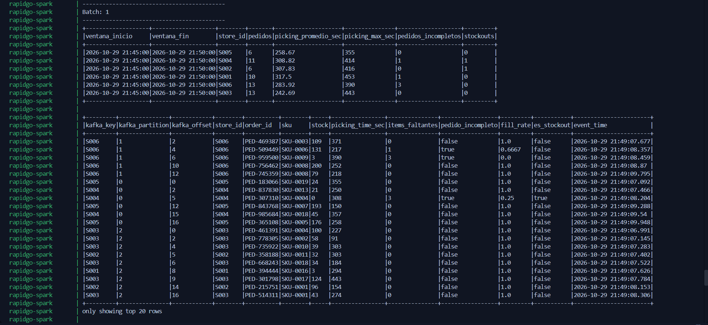
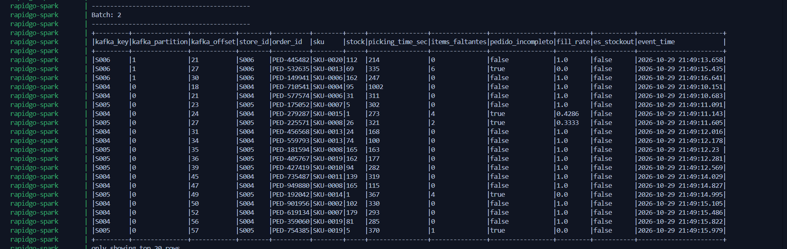
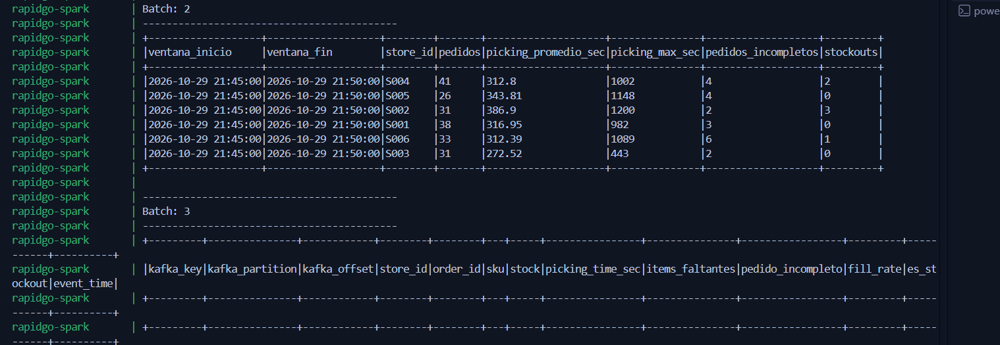

# Checkpoint Semana 2

**Variante 10 – Inventario y fulfillment** · Release objetivo: `v0.2.0-streaming`

## 1. Qué quedó funcionando esta semana

- Producer → Kafka (topic `inventario-fulfillment`, 3 particiones, key = `store_id`) en Docker.
- Spark Structured Streaming consume el topic, parsea el JSON con el esquema del contrato y lo deja en columnas tipadas (Issue #14).
- 3 transformaciones: limpieza y deduplicación, métricas de pedido (`items_faltantes`, `pedido_incompleto`, `fill_rate`) y métricas operativas (`picking_time_min`, `es_stockout`) (Issue #15).
- Agregación por ventana de 5 minutos: picking promedio por tienda (Issue #15).
- 19 pruebas automatizadas en verde (`python -m pytest -v`).
- [COMPLETAR por el equipo: alertas #16, Parquet con checkpoint #17, ci.yml #19.]

## 2. Valor real observado en la ejecución

Se enviaron 200 eventos (`--count 200 --rate 20`). Resultado de `picking_por_tienda` en el Batch 2, ventana 21:45–21:50 (UTC):

| Tienda | Pedidos | Picking promedio (s) | Picking máx. (s) | Incompletos | Stockouts |
|---|---|---|---|---|---|
| S001 | 38 | 316.95 | 982 | 3 | 0 |
| S002 | 31 | 386.90 | 1200 | 2 | 3 |
| S003 | 31 | 272.52 | 443 | 2 | 0 |
| S004 | 41 | 312.80 | 1002 | 4 | 2 |
| S005 | 26 | 343.81 | 1148 | 4 | 0 |
| S006 | 33 | 312.39 | 1089 | 6 | 1 |

- La suma de pedidos es 41 + 26 + 31 + 38 + 33 + 31 = **200**: no se perdieron ni se duplicaron eventos.
- S002 tuvo el picking promedio más alto (386.90 s, con un caso de 1200 s) y S003 el más bajo (272.52 s).
- Distribución de los 200 eventos por partición de Kafka: p0 = 67, p1 = 33, **p2 = 100** (ver ADR-002).

## 3. Decisión técnica tomada y por qué

- **Ventana tumbling de 5 minutos con watermark de 10 minutos**, y deduplicación por `(event_id, event_time)`. El watermark acota el estado que Spark guarda; la deduplicación protege frente a reenvíos del producer (Kafka entrega "al menos una vez").
- **Mantener `store_id` como key y 3 particiones**, a pesar del desbalance observado. Detalle y alternativas en `docs/decisions/ADR-002-key-y-particiones-observadas.md`.

## 4. Problema encontrado y cómo se resolvió

Al correr `pytest` en Windows fallaron **9 de 19** pruebas (10 pasaron) con `Python worker failed to connect back`. El log mostraba el mensaje del sistema: *"no se encontró Python; ejecutar sin argumentos para instalar desde el Microsoft Store..."*. Spark lanzaba su proceso de Python y Windows lo redirigía al acceso directo de la Microsoft Store en lugar de al Python instalado.

**Solución:** en el fixture de `tests/test_spark_transformaciones.py` se fijan `PYSPARK_PYTHON` y `PYSPARK_DRIVER_PYTHON` con `sys.executable`. Resultado: **19 passed in 30.11s**.

